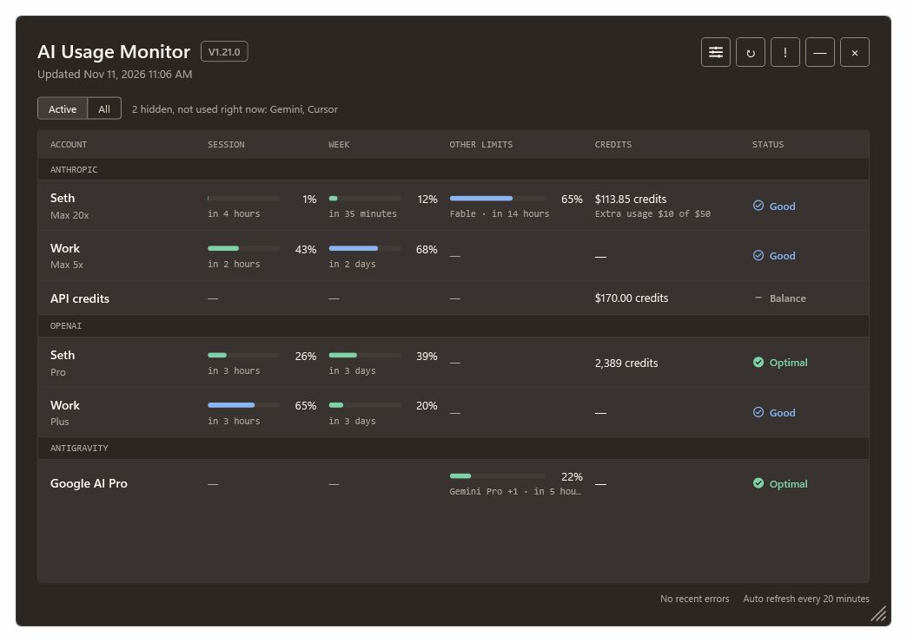
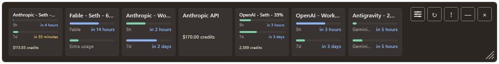
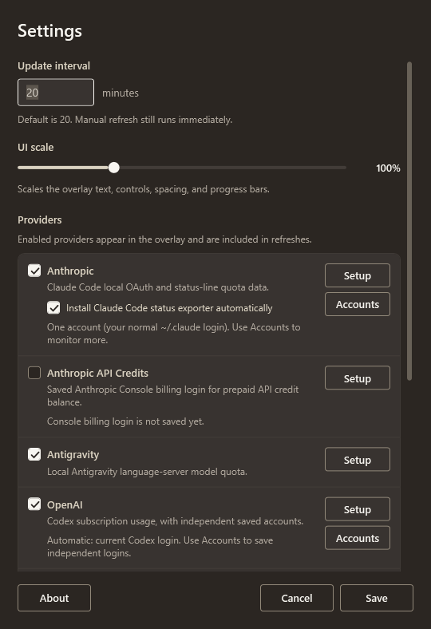
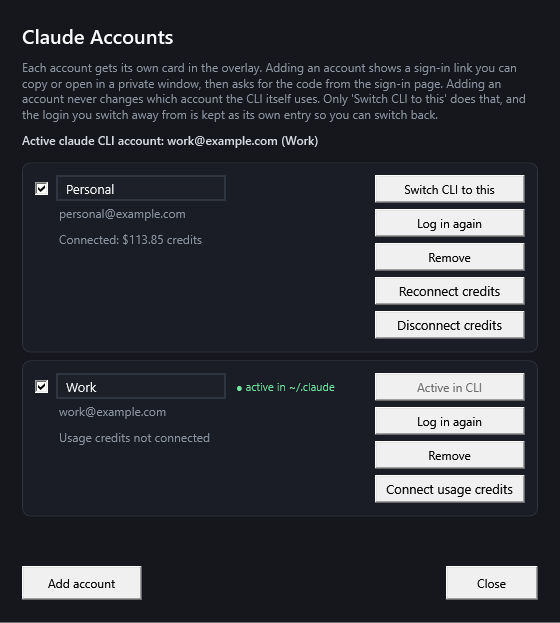
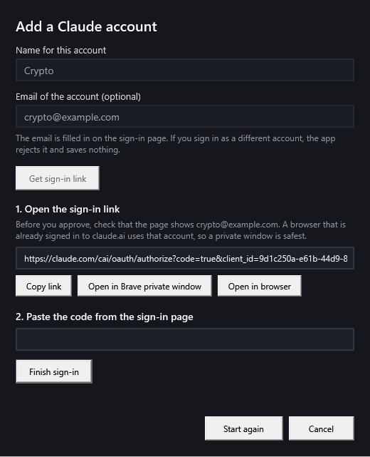
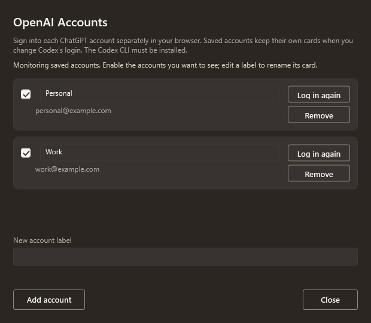

# AI Usage Monitor

Based on [Seth's AI Usage Monitor](https://github.com/SethRobinson/AIUsageMonitor) by Seth A. Robinson (MIT). This copy is rebranded and maintained for personal use.

At full size the overlay is one table: a group per provider, a row per account, and the same columns for every account, so you can compare accounts at a glance. **Active** hides providers you are not using (no usage this period, or no data). **All** shows them again. It uses the VortexOne dark design language: a warm canvas, and a status with an icon and a label (Optimal, Good, Watch, Needs attention) instead of colour alone.



Make the window smaller and it changes to compact cards, then to a one-line strip. Both hide unused providers too.




Settings let you pick the refresh interval, UI scale, which providers appear, whether the overlay stays always-on-top, and more:



Monitor multiple Claude accounts side by side, each with its own row in the table, and switch which account the claude CLI uses with one click:



Adding a Claude account never opens a browser by itself. Copy the sign-in link or open it in a private window, then paste the code. The app checks who signed in before it saves anything:



Save multiple OpenAI accounts and monitor them independently of the login currently used by Codex:



# Install #

This is a personal copy of [SethRobinson/AIUsageMonitor](https://github.com/SethRobinson/AIUsageMonitor), forked at V1.21. It needs the .NET 10 SDK (`winget install Microsoft.DotNet.SDK.10`). Build and install it on this PC with:

```powershell
powershell -NoProfile -ExecutionPolicy Bypass -File .\tools\install-local.ps1
```

The script installs to `%LOCALAPPDATA%\Programs\AIUsageMonitor` and starts the app. Run it again to update. Settings and saved accounts are kept. Changes since the fork are in [CHANGELOG.md](CHANGELOG.md).

# What's new #

- **V1.21:** Settings are now saved with an atomic write (written to a temp file, flushed to disk, then renamed into place), so a power outage mid-save can't leave you with a broken settings file. If one is ever unreadable anyway, the app sets it aside and starts fresh instead of getting silently stuck with no tray icon.
- **V1.20:** Claude usage credits show up on your account's card (connect them from the Claude Accounts dialog). Also fixed some multi-account mixups.
- **V1.19:** Purchased ChatGPT credits show up on OpenAI cards.
- **V1.18:** Save multiple OpenAI accounts and monitor them separately. Account names now show on compact cards too.
- **V1.17:** Notices when you log into a different Claude account outside the app, so cards don't get mixed up.
- **V1.16:** Better layouts at all window sizes.
- **V1.15:** Resize the window from any edge, plus a new stacked layout for tall, narrow windows.

# Info #

Windows tray app for checking remaining AI subscription usage across Anthropic, OpenAI/Codex, Antigravity, Gemini, and Cursor.

Warning: refreshing stale Anthropic data or automatic OpenAI data may run a tiny CLI probe, which can consume a small amount of your plan usage. Saved OpenAI accounts read quota directly through Codex account requests without sending a model prompt.

This is app was stupid easy to make, so you have a need for it, you undoubtely can just have AI make your own.  Even so, I like to put things like this on Github though to stay organized and have reliable source backups.

- Always-on-top overlay with percentage used (the same direction as Claude Code's `/usage`), reset times, plan names, and per-provider last checked status.
- Supports Anthropic, OpenAI/Codex, Antigravity, Gemini, and Cursor local usage checks.
- Multiple accounts for OpenAI and Anthropic (Claude), each with its own label and a row under its provider. Add and manage accounts in Settings.
- Claude usage credits: use **Settings > Anthropic > Accounts > Connect usage credits** beside each account, sign into that account on Claude, and select **Connect**. The app verifies the account and organization, then adds its prepaid balance to that account's Credits column and card, including the mini strip. Use **Reconnect credits** when the session expires or **Disconnect credits** to remove it. The additional website login is needed when Claude Code's usage response does not expose the balance.
- Anthropic API credits show as an **API credits** row under Anthropic, and keep an **Anthropic API** label on the mini strip. Console/API credits and Claude subscription usage credits remain separate balances.
- Purchased ChatGPT usage credits show as a "Credits" balance row on the OpenAI card (for saved accounts and the automatic Codex card) so you can see what is left once the plan windows hit 100% used.
- A model limit, such as Fable weekly, shows in the **Other limits** column of its account. A money cap such as extra usage shows under **Credits**. In the strips, small grouped cards keep their account labels, such as `Fable - Seth - 65%` (percent used).
- Tray controls for show/hide, refresh now, settings, logs, and exit.
- Layout adjusts as you drag the size to fit more or less info, UI scale slider in its Settings
- Provider errors go to copyable logs and use backoff to avoid hammering services.
- Build from VS Code with `dotnet build`; run with `dotnet run --project AIUsageMonitor.csproj`.
- Build and install a standalone Windows x64 exe on this PC with `tools\install-local.ps1`.

Requires Windows and the .NET 10 SDK for development.

Developer details and fake-test coverage: [OpenAI account architecture](docs/openai-accounts.md).

Claude billing authentication, account isolation, and refresh behavior: [Claude usage credits](docs/claude-usage-credits.md). This uses an undocumented website endpoint; website changes or browser challenges can temporarily prevent balance collection while quota monitoring continues.

## AI Disclosure

This project was developed with significant assistance from AI tools, both upstream and in this copy.

## Credits

Original app created by Seth A. Robinson - [GitHub](https://github.com/SethRobinson/AIUsageMonitor) | [Homepage](https://www.rtsoft.com/) | [Blog](https://www.codedojo.com/) | [Twitter](https://twitter.com/rtsoft) | [Bluesky](https://bsky.app/profile/rtsoft.com) | [Mastodon](https://mastodon.gamedev.place/@rtsoft)
